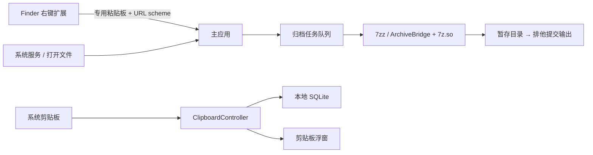

# FastBudo 架构

本文描述当前主分支实现。开发约束见 [AGENTS.md](AGENTS.md)，使用与构建见 [README](README.md)，发布变化见 [变更日志](CHANGELOG.md)。设计、计划与验证统一从 [文档索引](docs/README.md) 进入；历史设计不代表现有行为。

## 系统边界

FastBudo 是本地 SwiftUI / AppKit macOS 应用，由主应用、Finder Sync 扩展和随包分发的压缩引擎组成。没有 Web 壳、后台服务或云同步。当前工程与验证基线为 Apple Silicon / macOS 27。

## 模块地图

| 模块 | 责任与主要入口 |
|---|---|
| 应用生命周期 | [FastBudoApp.swift](App/FastBudoApp.swift)、[AppDelegate.swift](App/AppDelegate.swift)：菜单栏、设置、任务窗口及外部请求分发 |
| 版本更新 | [UpdateChecker.swift](App/UpdateChecker.swift)、[UpdateInstaller.swift](App/UpdateInstaller.swift)：正式版检查、发布包校验、同卷替换与重启 |
| 登录项 | [LoginItem.swift](App/LoginItem.swift)：通过 `SMAppService.mainApp` 管理，状态以系统为准 |
| Finder 入口 | [FinderSync.swift](FinderExtension/FinderSync.swift)、[FinderRequest.swift](Shared/FinderRequest.swift)：菜单快照、请求传递与校验 |
| 新建 | [NewItem.swift](App/NewItem.swift)、[FinderRename.swift](App/FinderRename.swift)、[NewItemTypes.swift](Shared/NewItemTypes.swift)：排他创建、原地重命名与常用后缀 |
| 归档调度 | [ArchiveModel.swift](App/ArchiveModel.swift)：串行任务、进度、取消、重试与展开确认 |
| 归档执行 | [ArchiveEngine.swift](App/ArchiveEngine.swift)、[ArchiveFiles.swift](App/ArchiveFiles.swift)：快照、子进程、文件复制及输出提交 |
| 原生桥接 | [ArchiveBridge.cpp](Native/ArchiveBridge.cpp)：结构化枚举、安全条目校验与解压 |
| 剪贴板协调 | [ClipboardController.swift](App/Clipboard/ClipboardController.swift)、[ClipboardCapture.swift](App/Clipboard/ClipboardCapture.swift)：采集、查询、复制与刷新 |
| 剪贴板数据 | [ClipboardStore.swift](App/Clipboard/ClipboardStore.swift)、[ClipboardItem.swift](App/Clipboard/ClipboardItem.swift)：SQLite、内容编码、备份及缩略图 |
| 剪贴板界面 | [ClipboardPanel.swift](App/Clipboard/ClipboardPanel.swift)、[ClipboardHotKey.swift](App/Clipboard/ClipboardHotKey.swift)：列表、详情与全局快捷键 |

## 生命周期与 Finder 请求

普通启动或再次点击应用图标打开设置；服务或文件触发时避免抢占设置窗口。关闭最后一个主窗口后切换为 accessory，移出 Dock，但菜单栏和剪贴板入口继续运行。

Finder 扩展处于独立沙箱进程，只构造菜单和请求，不执行压缩。菜单 tag 映射到扩展内部的请求快照。文件 URL 放入专用 `NSPasteboard`，`fastbudo://compress|create` 仅传递粘贴板名称与动作参数。主应用验证 scheme、host、参数唯一性及本地文件 URL；新建请求必须只有一个目标目录。系统“服务”经 [ServicesProvider.swift](App/ServicesProvider.swift) 和 [ServiceInput.swift](App/ServiceInput.swift) 进入归档流程。

常用新建后缀通过本机分布式通知同步，扩展独立缓存配置；不是共享数据库。选择项必须有共同父目录，跨目录搜索结果不猜测新建位置。创建任务在后台使用排他文件操作，遇重名自动编号，不覆盖已有内容。Finder 重命名仍在主线程进行有界 AX 遍历，确认唯一目标与前台 Finder 进程后触发回车；需要用户授予辅助功能权限。

## 归档数据流与安全边界

1. `ArchiveModel` 在主线程管理串行队列；`ArchiveEngine` 后台执行，锁保护子进程与取消状态。
2. 创建专属 `.fastbudo-UUID` 工作目录，归并输入路径并复制快照。复制按 1 MiB 分块，并逐块释放临时对象；当前仍是普通复制，没有 clone 或硬链接快照。
3. 创建归档调用随包 `7zz`；条目枚举和解压使用 `ArchiveBridge` 与 `7z.so`。tar.gz 使用中间 tar。分卷准备复用匹配计算，但仍需扫描并排序相邻目录内容。
4. 桥接验证条目类型、路径与资源预算，再写入暂存目录。人类可读的 `7zz` 列表不能充当路径安全边界；list 返回结构化条目，extract 成功仅返回 `{"ok":true}`。
5. 完成元数据与 quarantine 处理后，通过排他重命名提交输出；不覆盖输入或已有输出。失败、取消清理本任务工作目录，遗留路径记录到偏好设置供后续处理。

密码只经标准输入管道传递。子进程输出上限为 64 MiB，取消会终止子进程。展开大小、数量与压缩比超过阈值时要求确认，但确认不能绕过路径校验。结果 URL 历史最多保留 20 项，不影响磁盘文件。具体限制见 [README](README.md)。

## 剪贴板数据流与并发

`ClipboardController` 是主线程协调者。记录默认关闭；开启后每 0.5 秒检查 changeCount，timer 容差 0.1 秒。暂停时销毁 timer，恢复时跳过暂停期间的旧内容，快捷键保持独立。AppKit 粘贴板操作留在主线程，纯文本转换和数据库工作在后台执行。

采集过滤不支持的类型与敏感标记，并识别应用自身写入。允许文本、RTF、HTML、PNG、TIFF 和文件 URL，单条负载上限 20 MiB。新增内容复用编码及 SHA-256 哈希，以内容去重；历史按最近使用排序，手动顺序独立保存。

查询最多保留一个进行中的 reload 任务，并合并最新请求；generation 丢弃过期结果，不依赖 SQLite interrupt。面板隐藏时采集只持久化，显示时再加载。列表缓存筛选结果，批量快照只重建一次；紧凑行使用 Equatable 降低刷新，时间标签按分钟更新，详情按需读取，图片预览降采样。

复制流程为“后台取内容及转换 → 主线程写粘贴板 → 后台更新使用时间 → 局部调整顺序”。复制使旧快照失效，必要时重新查询，避免旧结果覆盖最近使用排序。剪贴板使用带 nonactivatingPanel + floating 样式的 NSPanel；后台先用 orderFrontRegardless 显示面板，再取得键盘焦点，不调用 NSApp.activate 带出设置或任务窗口。实际窗口顺序验证见[后台唤起验证](docs/validation/2026-10-22-clipboard-background.md)。默认 Control+Shift+V 唤起；操作是复制，不自动向其他应用粘贴。

## 持久化与备份

截图与贴图由 [ScreenshotController](App/Screenshot/ScreenshotController.swift) 管理，按需请求屏幕录制权限。区域截图由 [ScreenshotRegionSelector](App/Screenshot/ScreenshotRegionSelector.swift) 提供箭头指针与透明选区层，使用鼠标事件坐标支持快速拖动；完成后隐藏但保留选区面板，将 AppKit 点坐标换算为主屏左上原点，通过系统 `screencapture -R` 抓取。抓取完成后将同一面板所有权转交给编辑器，在原选区位置显示，面板保留整个桌面范围，外围继续灰显且不显示窗口阴影；拖图只移动画布与工具，不移动桌面面板。取消或失败由控制器清理未转交面板。图片点矩形与原始像素、透明工具占位区分别处理，工具位于目标屏可见区。窗口与指定屏幕仍由系统选取。选区与抓取各自最多等待 120 秒，退出时取消并释放选区续体。任务独占临时目录，完成后读取并清理。图片读取在后台进行，先检查大小与像素，拒绝超过 20 MiB 或四千万像素的内容。取消不写剪贴板，区域选择松开鼠标时按住 Control 将传入 `-c` 直接复制；系统窗口选择的 Control 点击保持原有语义。

[ImageEditor](App/Screenshot/ImageEditor.swift) 在原图坐标中保存标注并生成带标注的图片，复制/保存/贴图使用同一渲染结果。[PinnedImage](App/Screenshot/PinnedImage.swift) 使用非激活浮窗，关闭时断开视图和模型持有关系；最多 10 张、合计四千万原图像素，不自动持久化。菜单栏提供显示和取消穿透的恢复入口。历史贴图读取完整 payload，不改写剪贴板或最近使用排序。五个全局入口（剪贴板、普通截图、贴图、快速复制、快速下载）共享现有 Carbon 注册实现，按事件 ID 区分剪贴板、截图与贴图。编辑器使用无标题图片浮窗，工具覆盖层不参与图片导出。[ShortcutRecorder](App/Screenshot/ShortcutRecorder.swift) 仅在窗口内接收录入事件；录入时暂停全部五个入口，释放按键或修饰键后恢复，失焦/关闭取消。注册先成功再替换旧绑定，冲突不保存偏好。权限状态在设置出现、应用激活和截图前查询系统，不轮询或持久化。

| 数据 | 存储及约束 |
|---|---|
| 应用偏好 | UserDefaults；登录项启用状态直接查询系统 |
| 剪贴板历史 | `~/Library/Application Support/FastBudo/Clipboard/clipboard.sqlite`，NSLock 串行保护一个 SQLite FULLMUTEX 连接 |
| SQLite schema 2 | `clips(id, meta, payload, hash, search, bytes)` 与 `groups(name)`；元数据和负载仍在同一表 |
| 搜索 | `instr(lower(search), lower(?))` 子串匹配，保留中文及 `%`、`_` 的字面语义；未使用 FTS |
| 删除 | 开启 SQLite `secure_delete`；单条删除不执行 VACUUM，空间整理留到手动清理。此设置不等于底层磁盘或系统备份的取证擦除 |
| 备份 | 保留 v1 JSON，流式读写；总大小 2 GiB、单值 64 MiB、最多 10,000 条记录和 1,000 个分类；日期限定 1970–9999 |

导入在一个事务中完成，失败回滚；导出使用权限 0600 的临时文件并原子替换。历史及备份没有应用层加密，不应将本地存储理解为加密保险箱。不读取 iCopy 私有数据库，不上传剪贴板。

## 版本更新

检查、官网回退、Atom 和下载共享 `ReleaseSource`，目标为 `lliony/fastbudo`，源码仓库继续私有。客户端不附带仓库凭据，当前私有源无法保证匿名访问；API 或官网返回 404 时显示更新源不可访问或暂无正式版本，不会误报已是最新。本轮通过本地安装交付。

设置页手动触发检查，`UpdateChecker` 优先访问 GitHub Releases API；403/429 时读取官网 latest 跳转，只接受发行仓库 HTTPS 正式版标签。按三段数字比较版本，检查完成后才展示结果弹框；从 API 的可选 `body` 字段读取发布说明，以可选择的纯文本展示。API 正文为空或限流时，按同一版本标签读取官网 Atom 订阅并转换为纯文本；仍不可用时保留发布页入口。下载与安装由用户再次确认。

`UpdateInstaller` 在后台下载按当前编译架构命名的 ZIP 和同一发布的 SHA-256 清单，复用 `ArchiveEngine` 的安全解压及 Mac 属性恢复；随后验证应用标识、版本、架构、最低系统版本与签名完整性。校验和依赖 GitHub HTTPS 发布渠道，签名完整性检查不等同于开发者身份认证或公证。

下载使用 URLSession 落盘并观察任务实际接收字节数，避开 completion-handler 下载不转发的 delegate 回调，每 0.1 秒至多刷新一次进度（完成回调除外），超出上限提前取消；界面统一使用横向进度条，下载显示数字字节数与百分比，零字节为 0 B；其他阶段显示数字步骤，不虚构总进度。

暂存目录位于应用旁，权限 0700；更新任务由设置页持有，避免关闭弹窗取消安装。主线程确认没有归档任务、更新弹窗已解除附着后，才以同卷目录交换保留旧应用，再由主循环请求退出并通过辅助进程重启；退出请求返回不等于失败，等待 5 秒后进程仍未结束才回滚。进入目录交换阶段后不接受界面取消，以免提前回滚正在退出的应用。取消和准备失败只清理本次暂存目录。恢复能力与备份位置见 [README](README.md)；更新不修改剪贴板数据库和用户归档输出。

## 工程与验证边界

[project.yml](project.yml) 是工程配置源，包含主应用、Finder 扩展及 App 测试 target。引擎由 [build-engine.sh](scripts/build-engine.sh) 校验仓库内固定源码包后构建，资源随应用分发，不依赖运行时 Homebrew。修改配置后生成并提交 Xcode 工程，保持脚本沙箱启用。

验证命令见 [AGENTS.md](AGENTS.md)。Bridge 测试覆盖原生桥接与归档边界，App 测试覆盖 Swift 业务逻辑，Performance 测试提供独立进程内存回归检查；真实 Finder 权限、视图交互和安装包仍需人工验证。

两批优化结果见 [性能验证记录](docs/validation/2026-10-21-performance.md)。APFS clone、SQLite 拆表及 AX 后台迁移仍是条件方案，未接入生产流程；合成探针不能证明常驻内存、长期无泄漏或实际滚动帧率。网络卷与 Intel / macOS 26 不在本轮实测范围内。

截图输出目标由 `CaptureAction` 随本次任务闭包传入完成回调，不存成可被后续任务覆盖的目标字段。快速复制/另存为复用 `ImageEditorModel` 的后台PNG编码和无覆盖保存；另存为确认前可取消，失败回退原图编辑器。已确认导出事务保持不可取消，停止时取消路径选择并压制后续窗口。编辑器的ESC监听仅限自身与工具子窗口，附着模态面板放行；监听随视图拆除，不占用全局ESC，也不拦截快捷键录入。两个新快捷键初始未配置、可单独清除，保持旧偏好键兼容。
